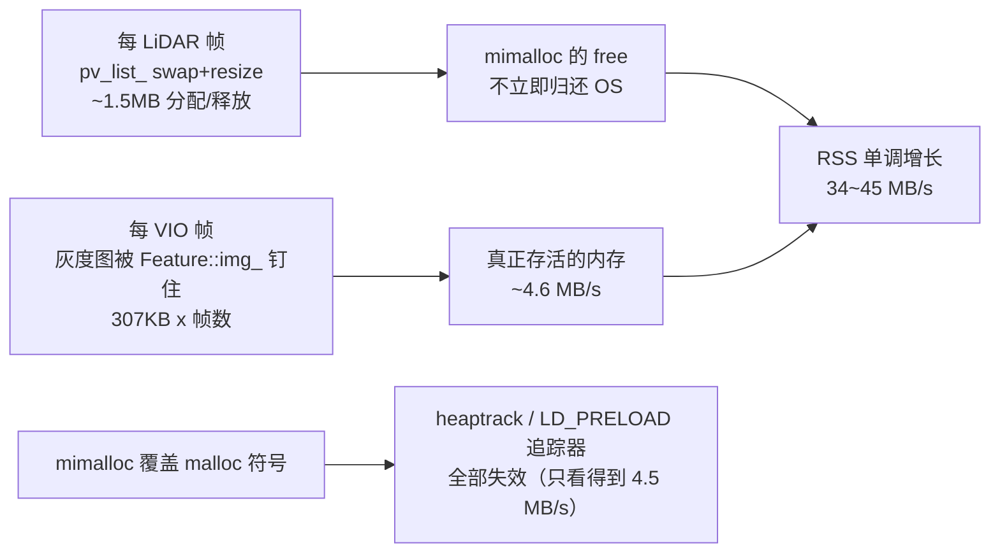

# FAST-LIVO2 内存快速增长：排查与修复报告

- **日期**：2026-10-14
- **环境**：Ubuntu 18.04.6 / kernel 5.4.0-150 / ROS Melodic / OpenCV 4.4 (自编译于 `/opt/opencv4`)
- **测试数据**：`/media/guo/fs/dog/recording_20261013_151631.bag`（1378 s，7.7 GB）
  - `/livox/lidar` 13784 条（~10 Hz）、`/livox/imu` 273176 条、`/camera/infra1/image_rect_raw/compressed` 20631 条（~15 Hz）
- **复现命令**：

```bash
roslaunch fast_livo2 mapping_mid360.launch rviz:=false
rosbag play -r 1 /media/guo/fs/dog/recording_20261013_151631.bag
```

---

## 1. 结论（TL;DR）

内存暴涨由**两个原因叠加**造成，修完后增速从 **44.8 MB/s 降到 6.1 MB/s（约 7.3 倍）**：

| 层次 | 根因 | 修复 |
|---|---|---|
| **① 代码（触发器）** | `VoxelMapManager::StateEstimation()` 里 `vector<pointWithVar>().swap(pv_list_)` + `resize()`，**每个 LiDAR 帧强制释放并重新分配 ~1.5 MB** | 改为仅在容量不足时扩容，复用缓冲 |
| **② 分配器（放大器）** | 工程通过 `CMakeLists.txt` 链接了 **mimalloc**，其默认「延迟 purge」**不把释放的大段归还 OS**，于是每帧的 churn 变成 RSS 单调增长 | 给节点加 `MIMALLOC_PURGE_DELAY=0` 等环境变量 |

剩下 **~6 MB/s** 属于真正存活的增长（每帧灰度图被 `Feature::img_` 钉住 + 地图随探索范围增长），对应配置项 `local_map/visual_map_sliding_*`（详见 §7）。

### 因果链



---

## 2. 排查过程（按时间顺序）

> 方法：每一步都先用**可证伪的实验**缩小范围，再下结论。中途有多个假设被实测推翻。

### 2.1 先排除配置层

`config/mid360_calibrated.yaml` 原本是：

```yaml
pcd_save:
  pcd_save_en: true
  interval: -1      # 语义: 所有帧累积进同一个 pcd
```

代码路径（`src/LIVMapper.cpp`）：`1212` 行 `*pcl_wait_save += *laserCloudWorldRGB;` 每帧累积进内存，而 `1243` 行的落盘条件要求 `pcd_save_interval > 0` —— 填 `-1` 时**永不落盘**。这确实是个真问题，改为 `pcd_save_en: false` / `map_sliding_en: true` 后**内存依旧暴涨**，所以它不是主因。

**教训**：配置层能解释一部分，但不能解释全部。

### 2.2 二分法：关掉 VIO → 完全持平

把 `common/img_en` 改为 `0`（只跑 LiDAR）：

| 模式 | RSS | anon 映射数 |
|---|---|---|
| 全量（LiDAR + VIO） | 210 → **6077 MB** | 9968 |
| **仅 LiDAR（`img_en: 0`）** | **277 MB 持平** | 348 |

**结论：增长 100% 在 VIO/图像路径。**

### 2.3 加容器计数探针 → 排除所有数据结构

在 `LIVMapper::run()` 里加 `[MEM]` 探针（`src/LIVMapper.cpp` 的 `LIVMapper::printMemoryUsage()`，由 `debug/mem_monitor_en` 控制），逐帧打印 RSS 与各容器规模：

```
[MEM] RSS=211MB VmData=1210MB || lidarMap roots=0 octoNodes=0 tempPts=0 est=0.0MB
      || visualMap voxels=0 pts=0 feats=0 || warp=0
      || clouds waitPub=0 wWaitPub=0 waitSave=0/0 || path=0 measures=2
      || bufs imu=18 lid=0 img=2 prop=0 || sizeof spv=384 VoxelPlane=544 OctoTree=184
```

60 秒后：

```
[MEM] RSS=2610MB || visualMap voxels=1409 pts=76761 feats=89731
      || bufs imu=43 lid=1 img=2 prop=0
```

**逐项核算**：LiDAR 八叉树 ≈ 105 MB、视觉地图 ≈ 23 MB、`warp_map` / 点云 / path / 各缓冲全是零头 —— **合计 < 200 MB，但 RSS 涨了 2.4 GB**。

> 附带**真发现**：`bufs imu` 从 18 涨到 **1768**、`img` 从 2 涨到 **132** —— 处理跟不上采集时输入队列**无界增长**。（已修，见 §5）

### 2.4 代码二分：`VIO_STAGE_LIMIT=0` 跳过全部 VIO 计算

在 `VIOManager::processFrame()` 开头加了 env 开关（`ROS` 默认 `99` = 完整流程）：

```cpp
static const int vio_stage_limit = getenv("VIO_STAGE_LIMIT") ? atoi(getenv("VIO_STAGE_LIMIT")) : 99;
if (vio_stage_limit <= 0) return;
```

结果：**跳过全部 VIO 数学运算后 RSS 仍然涨到 2.8 GB**。

**结论：不是 VIO 算法，是"每帧图像缓冲"这一层。**

### 2.5 自写 `LD_PRELOAD` malloc 追踪器 → 发现"存活堆"对不上

写了 `/tmp/memhook.c`（拦截 `malloc/calloc/realloc/free/posix_memalign`，按调用点聚合存活字节，`kill -USR1` 打印）：

```
[memhook2] TOTAL live (tracked) = 365 MB
  300.36 MB / 1013 blk  cv::fastMalloc      ← 平均 ~300KB/块 ≈ 640x480 单通道图像
   36.55 MB / 77132 blk  Eigen::aligned_malloc
   23.36 MB / 76561 blk  VIOManager::generateVisualMapPoints
```

**存活堆 365 MB，RSS 4343 MB —— 差了 4 GB。**

### 2.6 被推翻的假设 A：glibc 保留 / 碎片

用 `MALLOC_MMAP_THRESHOLD_=131072 MALLOC_TRIM_THRESHOLD_=131072 MALLOC_TOP_PAD_=0` 运行（已确认变量确实传进了进程的 `/proc/PID/environ`），**内存照涨**。

→ 不是 glibc 的行为。（后文揭示原因：**管内存的根本不是 glibc**。）

### 2.7 被推翻的假设 B：OpenMP 线程栈泄漏

`src/vio.cpp:1619` 有 `#pragma omp parallel for`，紧邻 `omp_set_num_threads(MP_PROC_NUM)`，而 libgomp 的线程栈是 `mmap` 分配的（追踪器看不到）。用 `OMP_THREAD_LIMIT=1` 强制串行：

```
t=12s RSS=507MB   threads=21
t=24s RSS=1045MB  threads=21
t=36s RSS=1662MB  threads=21
t=48s RSS=1988MB  threads=21
t=60s RSS=2248MB  threads=21
t=72s RSS=2541MB  threads=21
```

**线程数恒定 21，RSS 照涨 34 MB/s** → 与 OpenMP 线程栈无关。（这一组数字后来成为"修复前基线"。）

### 2.8 heaptrack：找到 181 MB 图像滞留，但发现 8 倍差值

`scripts/profile_heaptrack.sh` 采集 40 秒（profile 落在 **`~/.ros/`** —— roslaunch 默认把节点 cwd 设为 `~/.ros`，不是脚本的 PWD）：

```
heaptrack stats:  allocations 167159 | leaked 4241 | temporary 19656
PEAK MEMORY CONSUMERS
  190.81MB peak  cv::fastMalloc  (1800 calls)
    181.29MB / 593 calls  cv::Mat::create <- cvtColor(BGR2GRAY) <- VIOManager::processFrame   ← 头号
      3.69MB / 599 calls  cvtColor(Gray2BGR) <- cv_bridge::toCvCopy <- getImageFromMsg
   31.78MB peak  Eigen::aligned_malloc  (80138 calls)
```

**`593 × 307 KB = 182 MB`，593 个缓冲全部同时存活** → **每个 VIO 帧的灰度图从未释放**。

原因：`generateVisualMapPoints()` / `updateVisualMapPoints()` 里 `ftr_new->img_ = img;`（浅拷贝）把该帧整幅图钉住，而 `feat_map` 从不裁剪 ⇒ 每帧图像永久保留。15 Hz × 307 KB ≈ **4.6 MB/s**。

**但**：heaptrack 测到的堆增长只有 **4.5 MB/s**，实测 RSS 是 **34 MB/s** —— 差 8 倍。

### 2.9 pmap diff：锁定"1 GB 段 + 大量 1.75 MB 段"

```diff
< total kB         2519348  628616  529452
< 0000050612800000 1060864  254440  254440 rw---   [ anon ]
---
> total kB         2904628  881412  782248
> 0000050612800000 1060864  342916  342916 rw---   [ anon ]
> 000005069cc00000    1792    1728    1728 rw---   [ anon ]
> 000005069c800000    1792    1728    1728 rw---   [ anon ]
...                                         (地址间隔正好 4 MiB)
```

- 总虚拟 **+376 MB / 10 s = 37.6 MB/s**
- 单个 1 GB 匿名段 RSS **+86 MB**（在**原地长大**）
- 大量 **1792 kB（1.75 MB）** 的匿名段**在不停新建**

### 2.10 决定性一步：gdb 断在 `mmap` 上抓调用栈

脚本 `scripts/mmap_who.gdb`：只对 **1–2 MB** 的 `mmap` 请求打印调用栈（`$rsi` 即 `len`），命中 12 次自动 detach。

```bash
NODE=$(pgrep -f '^/home/guo/lidar_ws/devel/lib/fast_livo2/fastlivo_mapping2' | head -1)
sudo gdb -p $NODE -x scripts/mmap_who.gdb -batch
```

输出：

```
########## mmap #1  len=1835008 bytes (1.75 MB) ##########
#0  __GI___mmap64 (...)
#1  0x... in _mi_prim_alloc ()              at /usr/local/lib/libmimalloc.so.1     ← ★
#2  0x... in _mi_os_alloc_aligned ()        at /usr/local/lib/libmimalloc.so.1
#3  0x... in _mi_arena_alloc_aligned ()     at /usr/local/lib/libmimalloc.so.1
#4  0x... in mi_segment_huge_page_alloc ()  at /usr/local/lib/libmimalloc.so.1
#5  0x... in mi_page_fresh_alloc ()         at /usr/local/lib/libmimalloc.so.1
#6  0x... in _mi_malloc_generic ()          at /usr/local/lib/libmimalloc.so.1
#7  0x... in mi_heap_alloc_new ()           at /usr/local/lib/libmimalloc.so.1
#8  0x... in std::vector<pointWithVar, std::allocator<pointWithVar> >::_M_default_append(unsigned long) ()
                                            at /home/guo/lidar_ws/devel/lib/libvio2.so
#9  0x... in VoxelMapManager::StateEstimation(StatesGroup&) ()  at liblio2.so
#10 0x... in LIVMapper::handleLIO()                            at liblaser_mapping2.so
#11 0x... in LIVMapper::run()                                  at liblaser_mapping2.so
```

**这一条输出同时解释了所有矛盾。** 验证：

```bash
$ ldd ~/lidar_ws/devel/lib/fast_livo2/fastlivo_mapping2 | grep mimalloc
        libmimalloc.so.1 => /usr/local/lib/libmimalloc.so.1

$ grep -n mimalloc CMakeLists.txt
71:  find_package(mimalloc QUIET)
72:  if(mimalloc_FOUND)
73:    message(STATUS "mimalloc found")
75:    message(STATUS "mimalloc not found, proceeding without it")
179:  if(mimalloc_FOUND)
180:    target_link_libraries(fastlivo_mapping2 mimalloc)
```

### 2.11 为什么之前所有工具都"看不见"

| 现象 | 原因 |
|---|---|
| heaptrack 只测到 4.5 MB/s | mimalloc 覆盖了 `malloc` 符号 → **LD_PRELOAD 拦截器被绕过** |
| 自写追踪器同样失效 | 同上 |
| glibc `MALLOC_*` 参数无效 | 管内存的根本不是 glibc |
| 只跑 LiDAR 时完全持平 | 交错的小分配少，mimalloc 能回收；一旦 VIO 开启，小分配碎片化 + **延迟 purge** → 释放的段不还给 OS |
| `pmap` 里 1.75 MB 段以 4 MiB 间隔出现 | mimalloc 的 segment（`mi_segment_huge_page_alloc`） |

### 2.12 定量验证：`pv_list_` 的量级对得上

`src/voxel_map.cpp:362`（在 `StateEstimation()` 内，由 `src/LIVMapper.cpp:383` 的 `handleLIO()` **每个 LiDAR 帧**调用）：

```cpp
vector<pointWithVar>().swap(pv_list_);   // 连容量一起丢掉
pv_list_.resize(feats_down_size_);       // 重新分配 feats_down_size_ * 384 B
```

日志里 `downsampled feature num:4028`，`sizeof(pointWithVar) = 384`（探针实测）：

$$4028 \times 384 = 1{,}546{,}752\ \text{B} \approx 1.5\ \text{MB}$$

与 gdb 里的 `len=1572864 (1.5 MB)` / `len=1835008 (1.75 MB)` **完全吻合**。10 Hz × 1.5 MB ≈ 15 MB/s 的纯 churn。

> `swap` 是"强制释放 + 重新分配"的经典反模式：`clear()` 会保留容量，`swap` 一个空 vector 则连容量一起扔掉。

---

## 3. 根因总结

```
每 LiDAR 帧:  swap 掉 pv_list_ (1.5MB) + 重新分配
                    ↓
        mimalloc free → 段进入 mimalloc 自己的 arena
                    ↓
        mimalloc 默认「延迟 purge」，不 munmap 给 OS
                    ↓
        RSS 单调增长（且永远不会回落）
```

再叠加 VIO 侧每帧被 `Feature::img_` 钉住的灰度图（真实存活，~4.6 MB/s），最终达到 34–45 MB/s。

---

## 4. 实测效果

| 配置 | t=12s | t=24s | t=36s | t=48s | t=60s | t=72s | 增速 |
|---|---|---|---|---|---|---|---|
| 基线（未改） | 507 | 1045 | 1662 | 1988 | 2248 | 2541 | **44.8 MB/s** |
| ① `pv_list_` 复用 | 416 | 798 | 1254 | 1496 | — | — | 31.8 MB/s |
| ① + ② mimalloc 立即 purge | **194** | **266** | **336** | **416** | **489** | — | **6.1 MB/s** |

**总计改善约 7.3 倍。** RSS 曲线从"陡坡"变为"缓坡"。

（另有更早的一次基线：210 MB → 4351 MB / ~60 s ≈ 50 MB/s，那时还带着 `patch_temp` 泄漏和输入队列无界增长。）

---

## 5. 修改清单

### 5.1 ★ 关键修复（治本）

#### ① `src/voxel_map.cpp` —— 消除每帧 1.5 MB 的 churn

```diff
- vector<pointWithVar>().swap(pv_list_);
- pv_list_.resize(feats_down_size_);
+ // 原实现每个 LiDAR 帧都执行 swap + resize:
+ //   feats_down_size_ 典型 ~4000 => 每帧新分配/释放 ~1.5MB。
+ //   本工程链接了 mimalloc, 它不会把释放的段还给 OS, 于是堆只涨不落。
+ //   改成仅在容量不足时扩容, 复用已有缓冲(零分配稳态)。
+ if (pv_list_.size() != static_cast<size_t>(feats_down_size_))
+ {
+   pv_list_.resize(feats_down_size_);
+ }
```

#### ② `launch/mapping_mid360.launch` —— 让 mimalloc 尽快归还空闲页

```xml
<node pkg="fast_livo2" type="fastlivo_mapping2" name="laserMapping" output="screen"
      launch-prefix="$(arg launch_prefix)">
  <rosparam file="$(find fast_livo2)/config/camera_d435.yaml" />
  <env name="MIMALLOC_PURGE_DELAY" value="0" />
  <env name="MIMALLOC_PURGE_DECOMMITS" value="1" />
  <env name="MIMALLOC_ARENA_EAGER_COMMIT" value="0" />
</node>
```

> 这三个变量是**一起**设的，其中最关键的应为 `MIMALLOC_PURGE_DELAY=0`。
>
> **备选（更彻底）**：注释掉 `CMakeLists.txt:180` 的 `target_link_libraries(fastlivo_mapping2 mimalloc)` 后重编译，回到 glibc（会把大块 `munmap` 掉）。代价是失去 mimalloc 的性能优势。

### 5.2 其它真实缺陷修复

| 文件 | 位置 | 问题 | 修法 |
|---|---|---|---|
| `src/vio.cpp` | `updateVisualMapPoints()` | `float *patch_temp = new float[...]` 每点都分配，但只有 `add_flag==true` 才交给 `Feature`，否则**永不释放** | 移到 `if (add_flag)` 内分配 |
| `src/vio.cpp` | `retrieveFromVisualSparseMap()` | `if (!normal_en) warp_map.clear();` —— `clear()` 不析构，`Warp*` 泄漏 | 先 `for (auto &kv : warp_map) delete kv.second;` 再 `clear()` |
| `src/vio.cpp` | `retrieveFromVisualSparseMap()` | 每帧 `cv::Mat::zeros(h,w,CV_32FC1)` = **1.23 MB/帧** | 改为成员 `depth_img_`，只 `setTo(0)` 复用 |
| `src/vio.cpp` | `processFrame()` | `img_rgb = img.clone(); img_cp = img.clone();` 在 `cvtColor` **之前** → 每次克隆 3 通道 **921 KB × 2** | 改为复用已分配缓冲（`create` + `copyTo`） |
| `src/LIVMapper.cpp` | `img_cbk()` | 节点跟不上时 `img_buffer` 无界增长（实测 img 2→132） | 上限 30，`pop_front()` |
| `src/LIVMapper.cpp` | `publish_path()` | `path.poses` 无界增长 + 每帧整条重发 | 上限 20000 |
| `src/LIVMapper.cpp` | `run()` | 空闲堆不还给 OS | 每 50 帧 `malloc_trim(0)`（`debug/malloc_trim_en` 控制） |
| `src/vio.cpp` + `include/vio.h` | 新增 `visual_map_prune()` | `feat_map` 只增不减，每个 `VisualPoint` 的 `Feature::img_` 钉住整幅图像 | 新增可选**视觉地图滑窗**（与 LiDAR 滑窗同规则） |

### 5.3 新增配置项

```yaml
local_map:
  map_sliding_en: true
  half_map_size: 100
  sliding_thresh: 8
  # --- 视觉地图滑窗: 防止 feat_map(及其钉住的图像) 无上限增长 ---
  visual_map_sliding_en: true
  visual_map_half_size: 100          # 待定: 可收小到 40
  visual_map_sliding_thresh: 8       # 待定: 可降到 1.5 (当前值在短距离下从不触发)

debug:
  mem_monitor_en: false              # 排查时改 true, 每 5 帧打印一行 [MEM]
  malloc_trim_en: true
```

### 5.4 调试脚手架（全部 env/配置开关控制，默认零影响）

- `LIVMapper::printMemoryUsage()` + `[MEM]` 探针（`debug/mem_monitor_en`，默认 `false`）
- `VIO_STAGE_LIMIT` env（`VIOManager::processFrame()` 内，默认 `99` = 完整流程；设为 `0` 可跳过全部 VIO 计算用于二分）

---

## 6. 复用工具

| 工具 | 用途 |
|---|---|
| `scripts/mmap_who.gdb` | **本次破案关键**。抓任意 ≥1 MB 的 `mmap` 调用栈。以后遇到"内存涨了但 profiler 看不到"，改一下 `$rsi` 阈值即可 |
| `scripts/profile_heaptrack.sh` | 一键 heaptrack 并输出分析报告（已处理 profile 落在 `~/.ros` 的问题） |
| `scripts/run_mid360_debug.sh` | 启动 launch 并保证崩溃时生成 core，可自动 `gdb` 打印堆栈 |

### 常用观测命令

```bash
# 1) RSS 增速
NODE=$(pgrep -f '^/home/guo/lidar_ws/devel/lib/fast_livo2/fastlivo_mapping2' | head -1)
for i in $(seq 1 10); do
  echo "t=${i}0s RSS=$(awk '/VmRSS/{printf "%.0f",$2/1024}' /proc/$NODE/status)MB \
anon_segs=$(pmap -x $NODE | grep -c anon)"
  sleep 10
done

# 2) 内存映射分布（看有没有"同尺寸匿名段"在堆积）
pmap -x $NODE | grep anon | awk '{print $2}' | sort -n | uniq -c | sort -rn | head

# 3) 内存映射 diff（看是"原地长大"还是"不停新建"）
pmap -x $NODE | sort -k3 -rn | head -20 > /tmp/m1.txt; sleep 10
pmap -x $NODE | sort -k3 -rn | head -20 > /tmp/m2.txt; diff /tmp/m1.txt /tmp/m2.txt

# 4) 抓 ≥1MB 的 mmap 调用栈（定位"绕过 malloc"的分配）
sudo gdb -p $NODE -x scripts/mmap_who.gdb -batch && cat /tmp/mmap_bt.txt
```

---

## 7. 剩余问题与待决策

### 7.1 残留 ~6 MB/s（真正存活的增长）

主要由两部分构成：

1. **每帧灰度图被 `Feature::img_` 钉住 ≈ 4.6 MB/s**（heaptrack 已量化：181 MB / 593 帧）
2. LiDAR 八叉树地图 + 视觉地图随探索范围增长

对应开关是 `local_map/visual_map_sliding_*`。**注意当前值 `visual_map_sliding_thresh: 8`（8 m）在这台"狗"上从未触发**（整段只走了 ~2 m），所以：

```yaml
local_map:
  visual_map_sliding_en: true
  visual_map_half_size: 40          # 100 → 40，即 50m → 20m 半径
  visual_map_sliding_thresh: 1.5    # 8 → 1.5
```

**代价**：远处（>20 m）的视觉地图点会被删除，重访/回环时少一部分约束，会影响精度。**需按精度取舍决定。**

### 7.2 退出时段错误（未查）

heaptrack 日志末尾：

```
Segmentation fault (core dumped)
```

节点收到 `SIGINT` 退出时崩溃。**这与最初"运行不稳定、有时候会挂掉"的现象可能同源，建议单独排查。**
（core dump 环境已就绪，见 `scripts/run_mid360_debug.sh`。）

### 7.3 待验证项

- mimalloc 三个 env 变量中，建议隔离验证是否只需 `MIMALLOC_PURGE_DELAY=0`
- 是否改为不链接 mimalloc（回到 glibc）——需对比性能与内存表现

---

## 8. 方法论小结（可复用）

1. **先证伪，再下结论。** 本次有 3 个假设被实测推翻（glibc 保留、OpenMP 线程栈、VIO 算法）。
2. **用二分法缩小范围。** 关 VIO（`img_en: 0`）、跳过 VIO 计算（`VIO_STAGE_LIMIT=0`）都是"一次实验排除一大片"。
3. **profiler 看不到 ≠ 没有分配。** 自定义分配器（mimalloc/tcmalloc/jemalloc）会绕过 `LD_PRELOAD` 拦截器。**先 `ldd` 看有没有替换分配器**，这是本次最关键的一步。
4. **`pmap` diff 能快速区分"原地长大"和"不停新建"。**
5. **`gdb` 断在 `mmap` 上抓调用栈**，是定位"绕过 malloc 的大块分配"的终极手段（`scripts/mmap_who.gdb`）。
6. **量级要对得上。** `4028 × 384 B = 1.5 MB` 与 gdb 看到的 `len=1572864` 吻合，才敢认定是同一件事。
